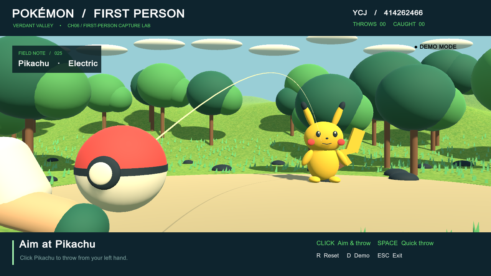
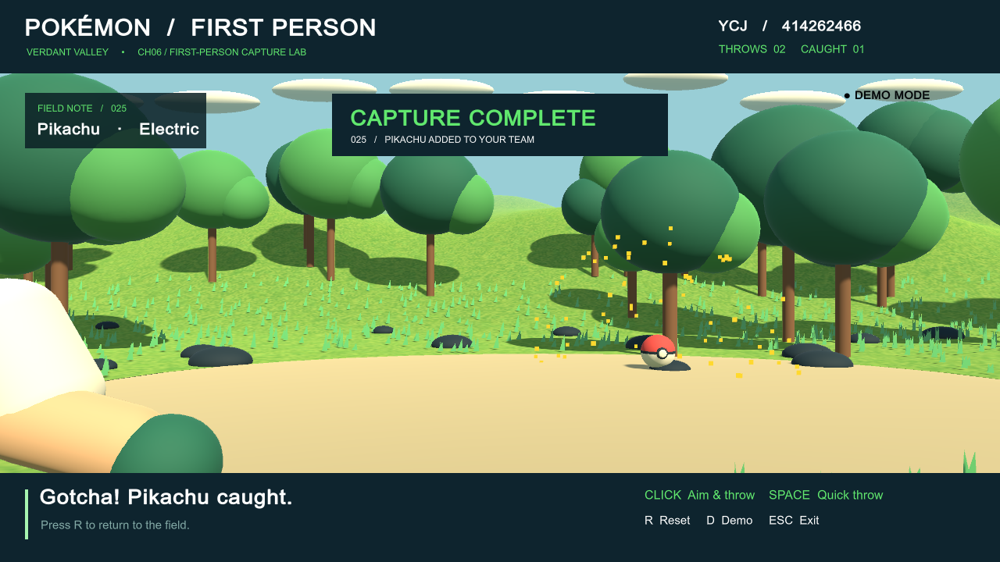

# VR 課程作業 5 - 第一人稱收服皮卡丘

---

## 🔗 相關連結與截圖

### 1. 專案截圖

### 2. GitHub 連結
* 專案儲存庫：[點此前往 GitHub](https://github.com/z9487xd/1151VR-HW5-414262466-YCJ)

### 3. YouTube 連結
* 成果演示影片：[點此觀看 YouTube 影片](https://youtu.be/KNPic_cANFA)

---

## 製作流程與操作說明

### 1. 製作流程
1. **場景建立**：用 Terrain 做地形、刷草地跟樹，再放訓練家、皮卡丘、精靈球，做成 Prefab 方便重複用。
2. **拋球物理**：寫 `CaptureGame` 用滑鼠射線瞄準，`Instantiate` 生出精靈球，加 Rigidbody 用 `AddForce` 丟出去，靠重力跑出拋物線。
3. **碰撞與特效**：精靈球的 `BallController` 在 `OnCollisionEnter` 判斷有沒有打到皮卡丘，打中就噴粒子、搖三下收服成功，沒打中可以再丟。
4. **音效與打包**：用程式產生簡單音效，最後 Build 成 Windows 執行檔。

### 2. 相關操作方法
* **拋球**：滑鼠左鍵點皮卡丘就會往那邊丟球，按 Space 是直接快速丟。
* **其他按鍵**：R 重來一局、D 播放示範、Esc 離開遊戲。
