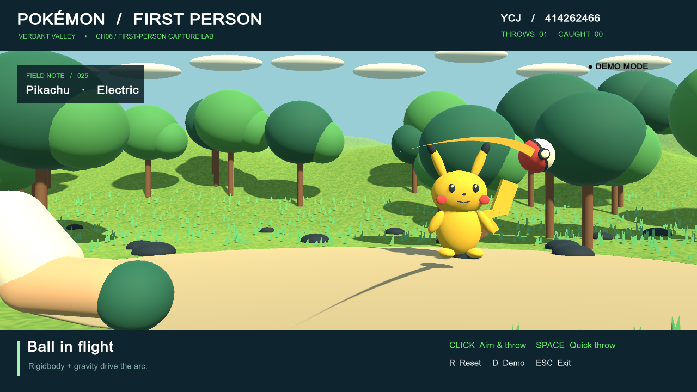

# 1151VR-HW5-414262466-YCJ

輔仁大學 Unity 3D VR 應用 — 作業五：第一人稱寶可夢收服。

- Unity 版本：6000.0.83f1
- 場景：`Assets/Scenes/VerdantValley.unity`
- 執行檔：`Builds/Windows/VerdantValley.exe`
- 操作：滑鼠左鍵瞄準並拋球；Space 快速拋球；R 重置；D 播放示範；Esc 離開。

## 專案截圖

